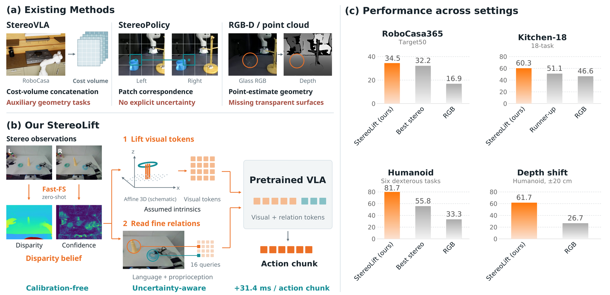
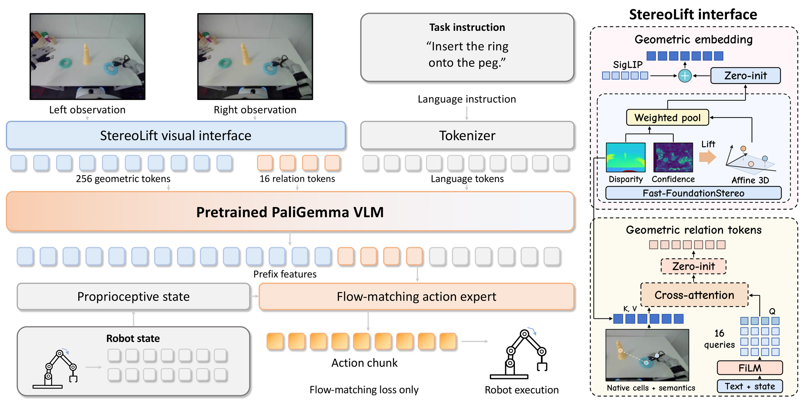
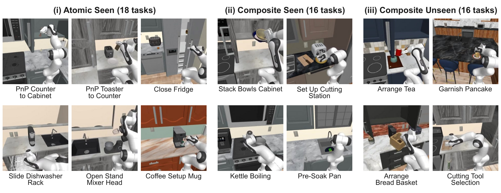
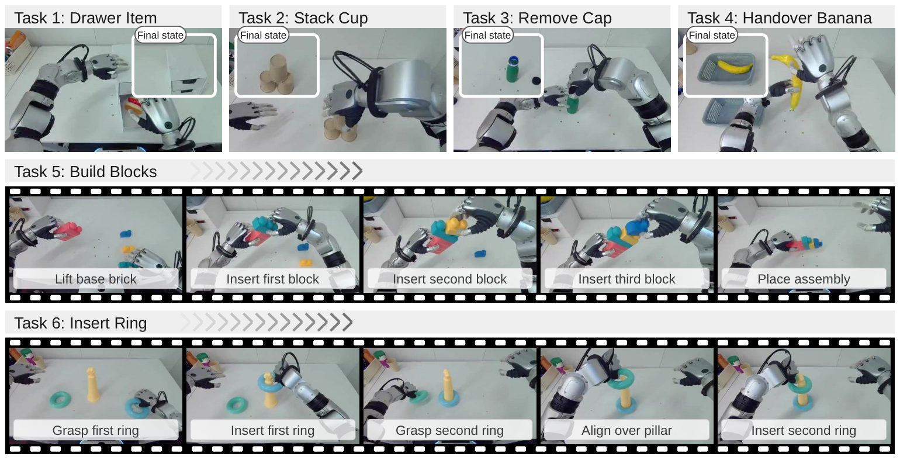

<div align="center">

<h2 class="papername"> StereoLift: Enhancing Vision-Language-Action Models for Precise Manipulation via Calibration-Free Stereo Lifting </h2>
<div>
<div>
    Wenhao Li<sup>1,2</sup>,
    Zhongyi Han<sup>1</sup>,
    Changfeng Sun<sup>3</sup>,
    Liang Han<sup>3</sup>,
    Yilong Yin<sup>1*</sup>,
    Liqiang Nie<sup>3</sup>
</div>

<sup>1</sup>School of Software, Shandong University &nbsp; <sup>2</sup>Shenzhen Loop Area Institute &nbsp; <sup>3</sup>School of Computer Science and Technology, Harbin Institute of Technology (Shenzhen)<br>
*Corresponding author

[](https://peacelwh.github.io/StereoLift/)
[](https://huggingface.co/datasets/Bluexxx/robocasa365_kitchen18)
[](LICENSE)

<h3 align="center">
<strong>
⭐ Give us a star if you like it! ⭐
<br>
✨ If you find this work useful for your research, please kindly cite our paper. ✨
</strong>
</h3>

</div>
</div>


## :fire: Updates

- [10/2026] :fire: Code, the Kitchen-18 dataset and the [project page](https://peacelwh.github.io/StereoLift/) released.

## Introduction

This is the official repository of *StereoLift: Enhancing Vision-Language-Action Models for Precise Manipulation via
Calibration-Free Stereo Lifting*.

Vision-language-action (VLA) models inherit rich semantics from large-scale pretraining but capture limited metric
geometry from monocular images, which hinders precise and contact-rich manipulation. Existing approaches inject
geometry through depth maps, point clouds or auxiliary 3D objectives, but typically require camera calibration,
discard depth uncertainty or modify the pretrained backbone. StereoLift is a calibration-free framework that
conditions a pretrained VLA on the disparity belief of a real-time zero-shot stereo foundation model:

1. a **geometric token embedding** lifts each visual token into an affine-equivalent 3D frame using assumed
   intrinsics and injects the lifted coordinate and belief into the token through a single zero-initialized
   projection;
2. **language-conditioned relation tokens** read hand-object relations at native disparity precision.

We prove that lifting preserves geometry up to a fixed linear map and show that belief conditioning never increases
flow-matching risk relative to point estimates. Experiments on RoboCasa365 show that, under a unified backbone and
training setup, StereoLift achieves the highest success rate among the compared stereo conditioning methods and raises
that of the base VLA from 16.9% to 34.5%. Notably, on a humanoid with two dexterous hands, StereoLift raises average
success from 33.3% to 81.7% while remaining robust to depth shifts.

<div align="center">

</div>

The overall framework is illustrated below. A frozen Fast-FoundationStereo model provides disparity belief features;
the geometric embedding lifts coordinates with assumed intrinsics and injects confidence-weighted geometry and belief
features into the SigLIP tokens; 16 language- and state-conditioned relation tokens read fine spatial relations at
the belief map's native resolution; PaliGemma and the flow-matching action expert are unchanged and training uses
only the flow-matching loss.

<div align="center">

</div>

## Installation

```bash
# Create and activate a conda environment with PyTorch (we used Python 3.12, torch 2.6.0 + CUDA 12.4)
conda create -n stereolift python=3.12 -y
conda activate stereolift
pip install torch==2.6.0 torchvision==0.21.0 --index-url https://download.pytorch.org/whl/cu124

# Clone StereoLift
git clone https://github.com/peacelwh/StereoLift.git
cd StereoLift

# LeRobot (pinned commit + a small patch, see third_party/README.md), Fast-FoundationStereo and its c-ffs weights,
# and this package (editable)
bash scripts/setup_third_party.sh

# Unit tests of the interface (no GPU needed)
python -m pytest tests -q
```

StereoLift registers itself with LeRobot as `policy.type=pi05_stereolift` when `stereolift` is imported;
`python -m stereolift.train` and `python -m stereolift.eval` are `lerobot-train` / `lerobot-eval` with the policy
registered. Behind a firewall set `HF_ENDPOINT=https://hf-mirror.com` for the downloads. Evaluation in RoboCasa365
additionally needs `robosuite` and `robocasa` with the RoboCasa365 assets (see
[docs/ROBOCASA365.md](docs/ROBOCASA365.md)).

The repository is organised as follows:

```
StereoLift/
  stereolift/                     the policy package (policy.type = pi05_stereolift)
    configuration_pi05_stereolift.py   configuration (every field is a --policy.* option)
    modeling_pi05_stereolift.py        pi0.5 policy with the stereo interface
    modules.py                         geometric token embedding, relation tokens
    lifting.py                         calibration-free affine lifting, Fourier features, token-grid pooling
    ffs_belief.py                      Fast-FoundationStereo wrapper exposing the disparity belief and confidence
    rectification.py                   vertical-shift / homography rectification
    robocasa_perturb.py                test-time stereo-rig perturbations for the robustness study
  scripts/                        setup, training and evaluation launchers, data tools
  configs/                        rectification homographies, Kitchen-18 task and episode lists
  docs/                           ROBOCASA365.md (Tables 1 and 2), REAL_ROBOT.md
  tests/                          unit tests of the interface
  third_party/                    LeRobot patch; LeRobot and Fast-FoundationStereo are installed here
```

## Data

* **RoboCasa365 Human300** (Table 1): the 300-task pretraining set in LeRobot format, e.g.
  `Whalswp/robocasa_pretrain_human300_v3` (official release: `ember-lab-berkeley/robocasa365-pretrain-*`). Only the
  two agentview cameras are used.
* **Kitchen-18** (Table 2): the 18 atomic target tasks with 100 or 30 demonstrations per task, released as a
  stand-alone LeRobot dataset with the stereo pair, the task manifest and the task-balanced statistics:
  [`Bluexxx/robocasa365_kitchen18`](https://huggingface.co/datasets/Bluexxx/robocasa365_kitchen18).
* **Fast-FoundationStereo weights**: `nvidia/c-fast-foundationstereo` (downloaded by `scripts/setup_third_party.sh`).
* **pi0.5**: `lerobot/pi05_base` (downloaded by LeRobot on first use).

See [docs/ROBOCASA365.md](docs/ROBOCASA365.md) for the data layout, the task-balanced sampler and statistics, and
the rectification of the toe-in camera pair.

## Training and Evaluation

See [docs/ROBOCASA365.md](docs/ROBOCASA365.md) for training and evaluating on RoboCasa365 under the official
Target50 protocol (Table 1) and the Kitchen-18 protocol (Table 2), the ablations and the robustness study.

See [docs/REAL_ROBOT.md](docs/REAL_ROBOT.md) for fine-tuning on a real-robot LeRobot dataset (the paper's humanoid
with two dexterous hands) and for the stereo-confidence signal used for failure monitoring.

In short:

```bash
# Table 1: Human300 -> Target50 (75k steps, global batch 64), then the official 50-task evaluation
DATASET_ROOT=/path/to/robocasa365_human300 RUN_NAME=target50_stereolift bash scripts/train_robocasa365.sh
CHECKPOINT=outputs/target50_stereolift/checkpoints/075000/pretrained_model OUTPUT_ROOT=outputs/eval/target50_stereolift \
  EVAL_GROUPS="atomic_seen composite_seen composite_unseen" N_EPISODES=50 N_ACTION_STEPS=25 bash scripts/eval_robocasa365.sh

# Table 2: Kitchen-18, 100 demonstrations per task (cosine schedule over 20k steps), then 50 rollouts per task
DATASET_ROOT=/path/to/robocasa365_kitchen18 RUN_NAME=kitchen18_100_stereolift \
  WARMUP_STEPS=500 STEPS=20000 DECAY_STEPS=20000 bash scripts/train_robocasa365.sh
CHECKPOINT=outputs/kitchen18_100_stereolift/checkpoints/<step>/pretrained_model OUTPUT_ROOT=outputs/eval/kitchen18_100_stereolift \
  TASK_FILE=configs/kitchen18_tasks.json N_EPISODES=50 N_ACTION_STEPS=5 bash scripts/eval_robocasa365.sh
```

## Experiments

The tables below are reproduced from the paper.

**RoboCasa365 Target50.** Success rates (%) under the official protocol, with Human300 training and 50 rollouts per
task. Except for the published pi0.5 result, all methods are trained in our codebase using the same recipe. The
comparison designs (Multi-view, RGB-D, StereoVLA and StereoPolicy) are described in the paper and are not part of
this release.

| Method | Atomic seen | Composite seen | Composite unseen | Overall |
|---|:-:|:-:|:-:|:-:|
| RGB (published pi0.5) | 39.6 | 7.1 | 1.2 | 16.9 |
| Multi-view | 56.4 | 24.4 | 9.4 | 31.1 |
| RGB-D | 55.9 | 23.0 | 7.6 | 29.9 |
| StereoVLA | 50.3 | 28.1 | 7.2 | 29.4 |
| StereoPolicy | 56.8 | 26.4 | 10.2 | 32.2 |
| **StereoLift (ours)** | **60.3** | **29.4** | **10.6** | **34.5** |

**Kitchen-18.** Success rates (%) with 50 rollouts per task. The 100-demonstration results report the task mean ±
standard error across 18 tasks; PnP is the mean over the five pick-and-place tasks; the last column is the same
design trained on 30 demonstrations per task. All methods share the backbone, data, rectification and training
configuration within each demonstration budget.

| Method | Conditioning representation | 100 demos | PnP | 30 demos |
|---|---|:-:|:-:|:-:|
| RGB | none | 46.6 ± 3.4 | 46.0 | 50.8 |
| Multi-view | second-view tokens | 50.8 ± 5.2 | 69.0 | 43.1 |
| RGB-D | disparity channel | 50.8 ± 5.8 | 64.4 | 44.8 |
| StereoVLA | pooled cost volume | 51.1 ± 5.6 | 46.0 | 39.3 |
| StereoPolicy | cross-view attention | 47.8 ± 5.0 | 46.0 | 50.2 |
| **StereoLift (ours)** | belief embedding + relation tokens | **60.3 ± 5.4** | **73.6** | **56.2** |

**Ablations** on Kitchen-18 with 30 demonstrations per task (success %, change in points relative to the full model).

| ID | Variant | Component assessed | Success | Δ |
|:-:|---|---|:-:|:-:|
| A | StereoLift (embedding + relation tokens + belief) | full model | 56.2 | 0.0 |
| B | without relation tokens | native-resolution geometric reading | 52.1 | −4.1 |
| C | without geometric token embedding | per-token spatial context | 50.0 | −6.2 |
| D | point estimate instead of belief ([b; c] → d_K) | information beyond the point estimate | 51.8 | −4.4 |

**Humanoid with two dexterous hands.** Successful trials out of 20 per task and the average success rate (%) on the
G1-D humanoid with two BrainCo dexterous hands. All policies are fine-tuned from pi0.5 using the same training
configuration.

| Method | InsertRing | StackCup | RemoveCap | BuildBlocks | Handover | DrawerItem | Average (%) |
|---|:-:|:-:|:-:|:-:|:-:|:-:|:-:|
| RGB | 8 | 9 | 7 | 0 | 9 | 7 | 33.3 |
| RGB-D | 10 | 11 | 9 | 2 | 11 | 9 | 43.3 |
| StereoVLA | 12 | 11 | 10 | 1 | 16 | 17 | 55.8 |
| StereoPolicy | 11 | 10 | 9 | 2 | 15 | 15 | 51.7 |
| **StereoLift (ours)** | **16** | **15** | **19** | **8** | **20** | **20** | **81.7** |

Under target depth shifts of ±20 cm StereoLift keeps 61.7% success (monocular RGB: 26.7%), and the mean stereo
confidence of the first action chunk after the approach predicts failures with an AUROC of 0.84 on the three
precision tasks.

**Efficiency.** Median latency (ms) for generating one 50-step action chunk on an A800 GPU with batch size 1,
256 × 256 inputs, K = 4 refinement iterations and 10 flow-matching steps; overhead relative to monocular RGB.

| | RGB | Multi-view | RGB-D | StereoVLA | StereoPolicy | StereoLift |
|---|:-:|:-:|:-:|:-:|:-:|:-:|
| Latency (ms) | 254.1 | 286.4 | 314.4 | 330.3 | 322.8 | 285.5 |
| Overhead (ms) | – | 32.3 | 60.3 | 76.2 | 68.7 | 31.4 |

<div align="center">


</div>

## Visualization

Rollouts of StereoLift on the six humanoid tasks and on RoboCasa365 Target50 are on the
[project page](https://peacelwh.github.io/StereoLift/). `scripts/visualize_beliefs.py` renders, for a trained
checkpoint, the rectified pair, the Fast-FoundationStereo disparity and confidence, and the attention of the relation
tokens over the native belief cells.

## :fire: Citation

If you find this work useful for your research, please kindly cite our paper.

```bibtex
@misc{li2026stereolift,
  title  = {StereoLift: Enhancing Vision-Language-Action Models for Precise Manipulation via Calibration-Free Stereo Lifting},
  author = {Li, Wenhao and Han, Zhongyi and Sun, Changfeng and Han, Liang and Yin, Yilong and Nie, Liqiang},
  year   = {2026},
  howpublished = {\url{https://github.com/peacelwh/StereoLift}}
}
```

## Acknowledgements

StereoLift builds on [LeRobot](https://github.com/huggingface/lerobot) and its pi0.5 implementation
([`lerobot/pi05_base`](https://huggingface.co/lerobot/pi05_base)), on
[Fast-FoundationStereo](https://github.com/NVlabs/Fast-FoundationStereo) and on the
[RoboCasa365](https://robocasa.ai) benchmark. We thank their authors for releasing their code, models and data.

## License

This repository is released under the [MIT License](LICENSE). LeRobot (Apache-2.0), Fast-FoundationStereo and its
weights (NVIDIA license) and the RoboCasa365 data keep their own licenses.
